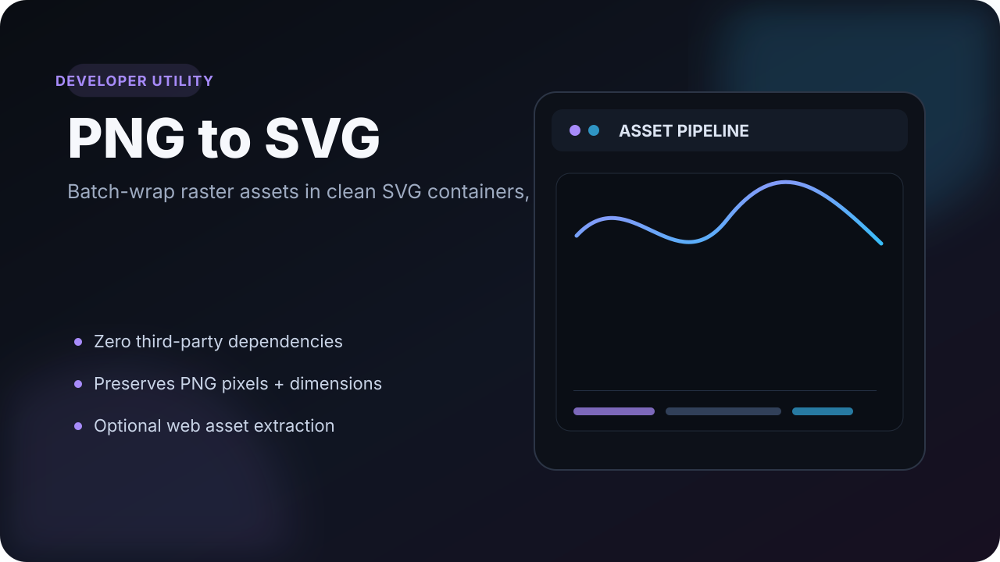

<p align="center">
  
</p>

# PNG to SVG

**A tiny Python utility for batch-wrapping PNG assets in SVG documents and preparing those wrappers for web use.**

This project solves a very specific asset-pipeline problem: take a folder of PNG files, preserve their exact raster appearance and dimensions, and produce SVG containers that can participate in an SVG-oriented workflow.

> **Important:** this is **not raster-to-vector tracing**. The original PNG pixels are embedded inside the SVG wrapper.

## Why this exists

Sometimes a pipeline expects `.svg` assets even though the source artwork is raster. Re-illustrating or vector-tracing the images would change them, while renaming files obviously does not work.

This tool keeps the image untouched and gives it a standards-compliant SVG container.

## Conversion pipeline

```text
input/*.png
    │
    ├─ validate PNG signature
    ├─ read IHDR width / height
    ├─ base64 encode original bytes
    ▼
output/*.svg
    │
    └─ <image href="data:image/png;base64,...">
```

The companion optimizer can then move the embedded PNG bytes back into normal cacheable assets while keeping the SVG wrappers:

```text
self-contained SVG
       │
       ▼
optimize-svg-for-web
       │
       ├─ tiny SVG wrapper
       └─ assets/*.png
```

## Requirements

- Python 3
- No third-party packages

## Convert a directory

```bash
git clone https://github.com/Khanos/png-to-svg.git
cd png-to-svg

./png-to-svg /path/to/input-pngs /path/to/output-svgs
```

Example:

```bash
./png-to-svg ./input-images ./svg-output
```

Each generated SVG preserves the PNG's original width, height and pixels.

## Optimize wrappers for web use

Base64 data makes a self-contained SVG convenient, but it also prevents the browser from caching the underlying PNG separately.

To externalize the raster payload:

```bash
./optimize-svg-for-web ./svg-output ./web-svg-output
```

Output:

```text
web-svg-output/
  image-a.svg
  image-b.svg
  assets/
    image-a.png
    image-b.png
```

If you specifically need each SVG to remain a single self-contained file:

```bash
./optimize-svg-for-web --inline ./svg-output ./web-svg-output
```

To preserve generated `<title>` elements while optimizing:

```bash
./optimize-svg-for-web --keep-title ./svg-output ./web-svg-output
```

## Useful details

- Reads PNG dimensions directly from the IHDR chunk
- Escapes generated SVG titles safely
- Handles conversion failures per file instead of aborting the entire batch
- Accepts upper- or lower-case `.png` extensions
- URL-encodes externalized asset paths
- Normalizes SVG dimensions when optimizing

---

Small tools are often the best kind of side project: one annoying workflow, one focused solution.
